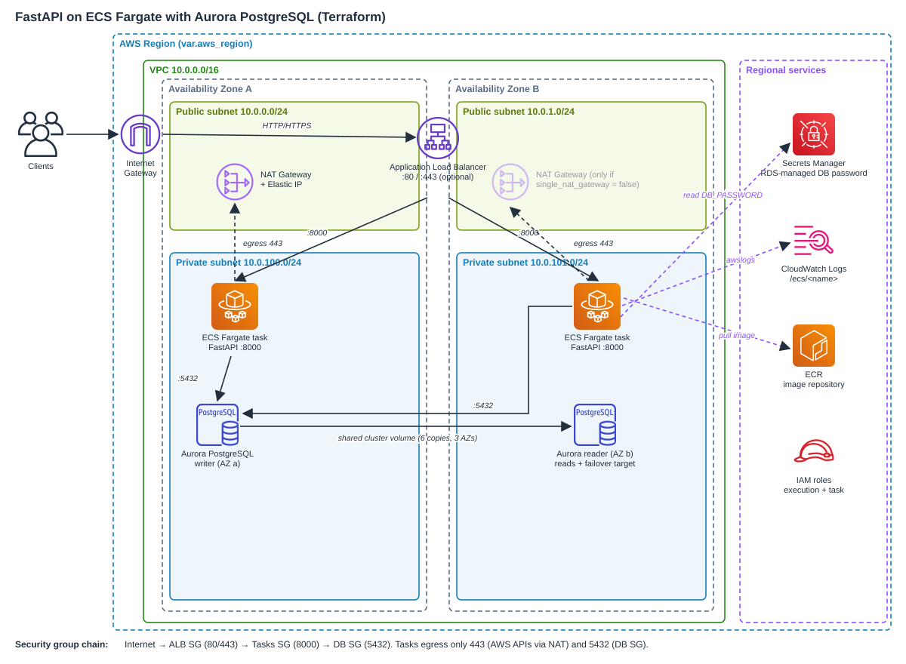

# Design and Cost

Design rationale, architecture and estimated monthly cost of the FastAPI on
ECS Fargate stack. For deploy, verify and cleanup steps see [README.md](README.md).

## Architecture

Request path: Client → Internet Gateway → ALB (public subnets) → ECS Fargate
task (private subnets, port 8000) → Aurora PostgreSQL cluster endpoint, i.e. the
writer (port 5432).

| Layer | Resource | Module |
|---|---|---|
| Network | VPC, 2+ public and 2+ private subnets, IGW, NAT, route tables | `modules/vpc` |
| Edge | Application Load Balancer, target group, HTTP (and optional HTTPS) listeners | `modules/alb` |
| Compute | ECS cluster, Fargate service, task definition, CPU autoscaling | `modules/ecs` |
| Image | ECR repository with scan-on-push and retention | `modules/ecr` |
| Data | Aurora PostgreSQL cluster: 1 writer + 1 reader in different AZs | `modules/rds` |
| Secrets | RDS-managed master secret in Secrets Manager | `modules/rds` |
| Observability | CloudWatch log group (`/ecs/<name>`) | `modules/ecs` |

The icons are from the AWS Architecture Icons set as bundled in the open-source
`diagrams` Python package. Use is subject to AWS's icon terms.

## Design decisions

### Network
- **Two AZs minimum, enforced.** `az_count` has a validation (`>= 2`), and the
  VPC module rejects any CIDR list whose length differs from the AZ count.
  One AZ loss must not take the service down.
- **Public subnets hold only the ALB and NAT. Tasks and databases are private.**
  Nothing that runs code or stores data has a public IP.
- **Stable subnet addressing.** Public subnets use `/24` index `0..n-1`, private
  ones start at index `100`, so adding an AZ later never renumbers existing subnets.
- **One shared NAT by default** (`single_nat_gateway = true`). It is the largest
  fixed cost after compute; the trade-off is that an AZ failure of the NAT cuts
  egress for every private subnet. Set `false` for one NAT per AZ.

### Compute
- **Fargate** removes node patching and capacity planning for a small stateless API.
- **Tasks register by IP** (`target_type = "ip"`), which `awsvpc` networking requires.
- **ALB health check uses `/health`, not `/db-check`.** `/health` does not touch
  the database. If the database blips, a DB-dependent check would mark every task
  unhealthy at once and turn a short DB incident into a full outage. `/db-check`
  stays available for humans and monitoring.
- **Safe deployments.** The deployment circuit breaker rolls back a bad image or
  config automatically, and a 60 s health-check grace period lets the app start.
- **Autoscaling** tracks average CPU at 60 % between `desired_count` and `max_count`.
  Terraform ignores `desired_count` after creation so an `apply` never fights the
  autoscaler.
- **CPU architecture is explicit** (`cpu_architecture`). The image must be built
  for the same platform, otherwise tasks fail with `exec format error`.

### Database
- **Managed database instead of a Postgres container.** Fargate has no durable
  local volume.
- **Aurora PostgreSQL, 1 writer + 1 reader.** The first design (RDS instance,
  Multi-AZ, plus an instance read replica) failed on deploy: RDS does not allow a
  read replica of an instance whose master password is managed by Secrets
  Manager. Aurora readers are cluster members that share the cluster volume, so
  they work with a managed password. One reader covers both needs: it serves
  reads through the reader endpoint and is the failover target, so nothing sits
  idle the way an RDS Multi-AZ standby does. History, AWS references and the
  alternatives: [docs/read-replica-deferred.md](docs/read-replica-deferred.md).
- **Failover.** The cluster volume keeps six copies across three AZs. The writer
  and reader run in different AZs (`promotion_tier` 0 and 1). If the writer fails,
  Aurora promotes the reader, typically within about a minute or less, and the
  cluster endpoint (`DB_HOST`) moves with it, so the app needs no configuration
  change.
- **`db.t4g.medium` and version 17.9.** The smallest provisioned class Aurora
  PostgreSQL offers, and AWS's current default version (both checked in
  `us-east-1` with `describe-orderable-db-instance-options` and
  `describe-db-engine-versions`). Instances take minor upgrades automatically, and
  Terraform ignores `engine_version` drift so the next plan does not try to
  downgrade.
- **Private, encrypted, no public access.** `publicly_accessible = false`,
  `storage_encrypted = true`, subnet group on private subnets only.
- **Safe-by-default knobs for dev, strict for prod.** `deletion_protection`
  defaults to `false` and skips the final snapshot for easy teardown; production
  should set `db_deletion_protection = true`.

### Secrets
- **RDS generates and stores the password** (`manage_master_user_password`). It
  never appears in Terraform code, `tfvars` or state.
- **ECS injects the password at task start** through the task definition `secrets`
  block, so it is not in the image or in plain-text environment variables.

### IAM and security groups (least privilege)
- **Execution role** (used by the ECS agent) has a scoped inline policy instead
  of the broad AWS-managed one: image pull only from this ECR repository, log
  writes only to this log group, secret read only for the DB secret.
  `ecr:GetAuthorizationToken` is the one `*` resource because AWS does not support
  scoping it.
- **Task role** (used by the application code) is empty because the app calls no
  AWS APIs. It exists so permissions can be added later without redesign.
- **Security groups reference each other, not CIDRs.**

  | From | To | Port |
  |---|---|---|
  | Internet | ALB SG | 80 / 443 |
  | ALB SG | Tasks SG | 8000 |
  | Tasks SG | DB SG | 5432 |
  | Tasks SG | Internet via NAT | 443 only |

  The ALB has no other egress; the DB has no egress at all.

### Observability
- Container logs go to CloudWatch with the `awslogs` driver, 30-day retention.
- CPU-based autoscaling is the only automation today. There are no alarms yet
  (see below).

### Code organisation
- Reusable modules with typed, validated variables and explicit outputs. The root
  module only wires modules together. Cross-module dependencies go through
  outputs, never through hard-coded IDs.

## Estimated monthly cost

Assumptions: `us-east-1`, on-demand, Linux x86, 730 hours/month, defaults of this
repo (2 AZs, 2 tasks of 0.25 vCPU / 0.5 GB, Aurora 2 × `db.t4g.medium`), 20 GB
NAT traffic, about 1 LCU, 1 GB of logs. Data transfer out stays inside the 100
GB/month free allowance.

Non-database rows come from the AWS Pricing Calculator (estimate date
2026-11-23). The calculator estimates were built for the earlier RDS design, so
their totals no longer match this stack. The Aurora rows come from the AWS Price
List API (`aws pricing get-products`, `us-east-1`, queried 2026-11-23); they have
not yet been entered into a calculator estimate.

| Item (calculator service) | Calculator input | USD / month |
|---|---|---:|
| NAT Gateway (VPC) | 1 gateway, 20 GB processed | 33.75 |
| Public IPv4 (VPC) | 3 in-use addresses (NAT EIP + 2 ALB IPs) | 10.95 |
| Application Load Balancer | 1 ALB, 1 GB/h processed, 1 new conn/s, 1 req/s (≈ 1 LCU) | 22.27 |
| AWS Fargate | 2 tasks × 730 h, 0.25 vCPU / 0.5 GB, Linux x86, 20 GB ephemeral | 18.02 |
| Aurora PostgreSQL instances (Price List API) | 2 × `db.t4g.medium` × 730 h × $0.073 | 106.58 |
| Aurora storage (Price List API) | 20 GB consumed × $0.10 (Aurora Standard) | 2.00 |
| Aurora I/O (Price List API) | 10 million requests × $0.20 per million (assumed) | 2.00 |
| Secrets Manager | 1 secret, 1,000 API calls | 0.41 |
| CloudWatch Logs | 1 GB ingested, stored 1 month | 0.50 |
| ECR | 0.5 GB stored | 0.05 |
| VPC, IGW, security groups, IAM, autoscaling | not billed | 0.00 |
| **Total (default)** | | **196.53** |

| Scenario | How | USD / month |
|---|---|---:|
| Default (this repo) | as above | 196.53 |
| Dev-lite | `-var db_instance_count=1` (writer only, no readable failover target; Aurora −53.29) | 143.24 |
| Higher availability | `-var single_nat_gateway=false` (2 NAT × 10 GB: 66.60; 4 public IPv4: 14.60; calculator figures) | 233.03 |
| Earlier RDS design, for comparison | `db.t4g.micro` Multi-AZ, no reader ([calculator estimate](https://calculator.aws/#/estimate?id=baaf3d0e788b1c454b25826137ba9463874085a6)) | 113.91 |

Aurora is the largest item (110.58 of 196.53): its smallest provisioned class is
`db.t4g.medium`, and every instance is billed, including the reader. The
"1 write, 1 read" requirement is what costs about $83/month more than the
earlier RDS design. Each extra Fargate task added by autoscaling costs about
$9/month while it runs (half of the 18.02 above). The fixed network cost (NAT,
public IPv4, ALB) is 66.97.

> Calculator figures are on-demand list prices for `us-east-1` and exclude tax,
> free tier, data transfer out (assumed inside the 100 GB/month free allowance),
> Aurora backup storage beyond the free allocation, and Fargate public IPs (tasks
> run in private subnets). Aurora storage and I/O depend on data size and query
> volume; 20 GB and 10 million I/Os are assumptions for a small API. Prices differ
> by region and change over time.

## Not implemented yet

| Item | Status |
|---|---|
| HTTPS | Implemented for `aethrclothes.shop`: existing ACM certificates are looked up (not requested) in `us-east-1`, so the stack deploys there |
| CloudWatch alarms and notifications | Not implemented |
| Remote Terraform state (S3) | Implemented: S3 bucket and DynamoDB lock from `terraform/bootstrap` |
| CI/CD pipeline | Implemented: GitHub Actions with OIDC (`.github/workflows/deploy.yml`); not yet run end to end |
| "1 write, 1 read" | Implemented with Aurora (writer + reader). The app still sends all queries to `DB_HOST`; `DB_READ_HOST` (reader endpoint) is injected but unused |
| Secret rotation handling | **Open risk:** RDS rotates the managed password every 7 days by default, and tasks read it only at start. Running tasks will fail to open new DB connections after a rotation until they are redeployed. See README |
