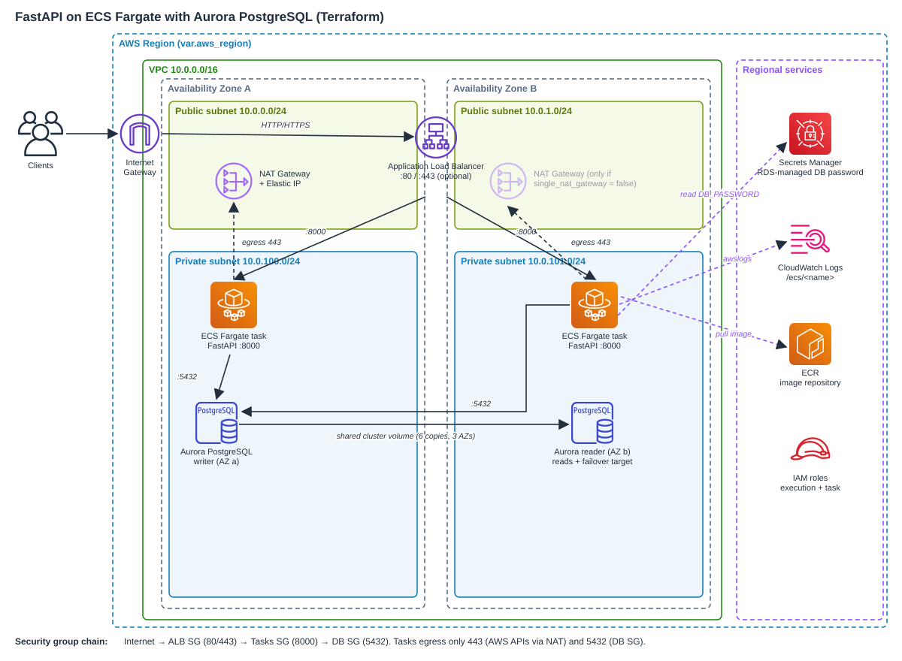

# Design Decisions and Estimated AWS Costs

Summary of how the `k8s-event-api` FastAPI service is deployed on AWS with
Terraform, why it is built this way, and what it costs per month. Deploy,
verify and cleanup steps are in [README.md](../README.md). Full detail behind
each point is in [DESIGN.md](../DESIGN.md).

## 1. What is deployed

| Layer | What | Terraform module |
|---|---|---|
| DNS and TLS | Route 53 alias records for `aethrclothes.shop` and `www`; existing ACM certificates on the ALB | `modules/dns`, `modules/alb` |
| Network | VPC `10.0.0.0/16` across 2 AZs: public subnets (ALB, NAT), private subnets (tasks, database), one NAT gateway | `modules/vpc` |
| Edge | Application Load Balancer: HTTPS on 443, HTTP 80 redirects to HTTPS | `modules/alb` |
| Compute | ECS Fargate service, 2 tasks (one per AZ), autoscaling 2 to 6 on CPU | `modules/ecs` |
| Image | ECR repository, scan on push, retention policy | `modules/ecr` |
| Database | RDS PostgreSQL 17: Multi-AZ primary (writes) + one read replica in the second AZ | `modules/rds` |
| Secrets | DB credentials in Secrets Manager, injected into tasks at start | `modules/rds`, `modules/ecs` |
| Monitoring | CloudWatch Logs, 10 alarms, Route 53 health check on `/db-check`, SNS email notifications | `modules/ecs`, `modules/monitoring` |
| Delivery | GitHub Actions with OIDC; Terraform state in S3 with DynamoDB locking | `.github/workflows/deploy.yml`, `bootstrap/` |

## 2. How the requirements are met

| Requirement | How it is met |
|---|---|
| Containerised FastAPI on AWS | ECS Fargate service behind an ALB; image built by CI, tagged with the commit SHA |
| High availability across AZs | 2 AZs minimum (enforced by validation); one task per AZ; ALB in both public subnets |
| PostgreSQL in private subnets | RDS in private subnets only, `publicly_accessible = false`, encrypted storage |
| Multi-AZ with failover | Multi-AZ primary: synchronous standby in another AZ, automatic failover, same endpoint |
| 1 write + 1 read | Primary (`DB_HOST`) takes writes; read replica (`DB_READ_HOST`) serves reads |
| Secrets not in code | Password in a GitHub secret and Secrets Manager; ECS injects it at task start |
| Least privilege | Scoped IAM roles; security groups reference each other instead of CIDRs |
| Infrastructure as code | Reusable Terraform modules, remote state with locking, CI plan on PR and apply on `main` |
| Observability | Container logs in CloudWatch; alarms notify by email on ALARM and OK |
| HTTPS | TLS on the ALB with the existing ACM certificates for the domain |

## 3. Design decisions

### Network

| Decision | Why | Trade-off |
|---|---|---|
| At least 2 AZs, enforced by a variable validation | Losing one AZ must not take the service down | Two of everything that is per-AZ |
| Only the ALB and NAT are public; tasks and database are private | Nothing that runs code or stores data has a public IP | Outbound traffic from tasks needs NAT |
| One shared NAT gateway by default (`single_nat_gateway = true`) | NAT is the largest fixed cost; one saves about $36/month | If the NAT's AZ fails, private subnets lose egress. `false` gives one NAT per AZ |
| Stable subnet numbering (public from `/24` index 0, private from 100) | Adding an AZ later never renumbers existing subnets | None |

### Compute

| Decision | Why | Trade-off |
|---|---|---|
| ECS Fargate | No servers to patch or size for a small stateless API | Higher price per vCPU than EC2 at large scale |
| ALB health check on `/health`, not `/db-check` | A database blip would otherwise mark every task unhealthy at once and turn a short DB incident into a full outage | A DB outage is not seen by the ALB, so a separate Route 53 check covers `/db-check` |
| Deployment circuit breaker with rollback, 60 s grace period | A bad image or config rolls back automatically | None |
| Autoscaling on average CPU 60 %, 2 to 6 tasks; Terraform ignores `desired_count` after creation | Follows load; `apply` never fights the autoscaler | Memory is not a scaling signal (an alarm covers it) |
| Explicit `cpu_architecture` | The image must match the platform, otherwise tasks fail with `exec format error` | The build must pass `--platform` |

### Database

| Decision | Why | Trade-off |
|---|---|---|
| Managed RDS instead of a Postgres container | Fargate has no durable local storage; RDS handles backups, patching and failover | Cost of a managed service |
| Multi-AZ primary + one read replica | The Multi-AZ standby only takes over on failover and serves no queries, so the "read" node has to be a separate replica | Replication to the replica is asynchronous, so reads can lag behind writes |
| Terraform sets the master password (`manage_master_user_password = false`) | RDS rejects an instance read replica when RDS manages the password itself. This failed on the first deploy ([finding](read-replica-deferred.md)) | The password is in Terraform state and is not rotated |
| `db.t4g.micro`, PostgreSQL 17 (major only) | Smallest Graviton class, enough for a small API; RDS applies minor upgrades | Low headroom (1 GiB RAM); resize with one variable |
| Aurora considered and replaced | Aurora works with a managed password and readers, but its smallest class is `db.t4g.medium` | It cost $110.58/month for the database against $41.94 now |
| Deletion protection off by default, final snapshot skipped | Easy teardown for a dev or demo environment | Production should set `db_deletion_protection = true` |

### Secrets, IAM and network security

| Decision | Why | Trade-off |
|---|---|---|
| DB password from the `DB_PASSWORD` GitHub secret, or generated by Terraform when unset | Never in the code or a committed file; validated at plan time against RDS rules | Stored in Terraform state, so the state bucket must be treated as secret |
| ECS `secrets` block injects `DB_PASSWORD` at task start | Not in the image or in plain-text environment variables | A password change needs new tasks |
| Scoped execution role: pull only from this ECR repo, write only to this log group, read only this secret | Least privilege instead of the broad AWS-managed policy | `ecr:GetAuthorizationToken` must stay `*` (AWS limitation) |
| Empty task role | The app calls no AWS APIs; permissions can be added later without redesign | None |
| Security group chain: Internet → ALB (80/443) → tasks (8000) → DB (5432); task egress only 443 and 5432 | Each tier accepts traffic only from the tier in front of it | None |

### Monitoring and alerting

| Decision | Why | Trade-off |
|---|---|---|
| One SNS topic, email on ALARM and OK | The recipient also learns when an incident is over | Each address must confirm the subscription |
| 10 alarms: ALB 5xx, target 5xx, unhealthy targets, no healthy targets, latency p95, ECS CPU and memory, DB CPU and memory, `/db-check` | Cover the user-visible symptoms and the main resource limits | Thresholds are starting values, to be tuned with real traffic |
| Route 53 HTTPS health check on `/db-check` from 3 regions | Detects a database or credentials failure that the ALB health check cannot see | About $1/month; Route 53 metrics exist only in `us-east-1` |
| "No data" counts as failure for healthy hosts and the health check | Silence there means nothing is reporting | None |

### Delivery

| Decision | Why | Trade-off |
|---|---|---|
| GitHub Actions with OIDC, no stored AWS keys | Short-lived credentials; roles trust only this repository (numeric owner and repo IDs) | One-time bootstrap stack run locally |
| Pull requests: read-only role, plan only. `main`: apply role in the `production` environment | Nothing changes in AWS before review | Applying needs a merge |
| Apply role limited to the services in this stack; IAM limited to roles named after the app | The pipeline cannot create an admin role | New services need a bootstrap change |
| Image tag = commit SHA; ECS wait and smoke test of `/health` and `/db-check` after apply | Every deploy is traceable and verified | None |
| Remote state in S3 (versioned, encrypted) with a DynamoDB lock | Shared, recoverable state; no concurrent applies | None |

## 4. Estimated monthly cost

Assumptions: `us-east-1`, on-demand, Linux x86, 730 hours per month, repo
defaults (2 tasks of 0.25 vCPU / 0.5 GB, `db.t4g.micro` Multi-AZ primary +
Single-AZ replica with 20 GB gp3 each), 20 GB through NAT, about 1 ALB LCU, 1 GB
of logs, data transfer out within the 100 GB/month free allowance.

Sources:
- Non-database rows: AWS Pricing Calculator, 2026-11-23.
- RDS rows: AWS Price List API (`aws pricing get-products`). `db.t4g.micro` costs $0.016/h Single-AZ and $0.032/h Multi-AZ. gp3 storage costs $0.115/GB-month Single-AZ and $0.23 Multi-AZ.

| Item | Input | USD / month |
|---|---|---:|
| NAT Gateway | 1 gateway, 20 GB processed | 33.75 |
| Public IPv4 | 3 addresses (NAT EIP + 2 ALB) | 10.95 |
| Application Load Balancer | 1 ALB, about 1 LCU | 22.27 |
| ECS Fargate | 2 tasks × 730 h, 0.25 vCPU / 0.5 GB | 18.02 |
| RDS primary | `db.t4g.micro` Multi-AZ (23.36) + 20 GB gp3 Multi-AZ (4.60) | 27.96 |
| RDS read replica | `db.t4g.micro` Single-AZ (11.68) + 20 GB gp3 (2.30) | 13.98 |
| Secrets Manager | 1 secret, 1,000 API calls | 0.41 |
| CloudWatch | 1 GB logs (0.50) + 10 alarms (1.00) | 1.50 |
| ECR | 0.5 GB stored | 0.05 |
| Route 53 health check | Basic check of an AWS endpoint (free) + HTTPS option | 1.00 |
| SNS | Email notifications within the free allowance | 0.00 |
| VPC, IGW, security groups, IAM, autoscaling | Not billed | 0.00 |
| **Total** | | **129.89** |

That is about **$4.30 per day** or **$0.18 per hour** while the stack exists.

### Where the money goes

| Group | USD / month | Share |
|---|---:|---:|
| Fixed network: NAT, public IPv4, ALB | 66.97 | 52 % |
| Database: primary + replica | 41.94 | 32 % |
| Compute: Fargate | 18.02 | 14 % |
| Everything else | 2.96 | 2 % |

### Scenarios

| Scenario | How | USD / month |
|---|---|---:|
| Default (this repo) | as above | 129.89 |
| Dev-lite | `-var db_multi_az=false -var db_create_read_replica=false` | 101.93 |
| Higher availability | `-var single_nat_gateway=false` (one NAT per AZ) | 166.39 |
| Previous Aurora design | 2 × `db.t4g.medium` writer + reader | 198.53 |

Each extra task added by autoscaling costs about $9/month while it runs.

### Ways to reduce cost

- Destroy the stack when it is not needed. Costs stop at once, apart from the
  bootstrap stack, which costs almost nothing.
- Use dev-lite for non-production environments: one DB instance, no replica.
- Add VPC endpoints for ECR, Logs and Secrets Manager. This lowers NAT data
  charges at higher traffic, but each interface endpoint has its own hourly fee.
- Use Reserved Instances (RDS) or Savings Plans (Fargate) for a long-lived
  production environment.

### Not included

Tax, the free tier, data transfer out above the free allowance, backup storage
beyond the free allocation, and the existing Route 53 hosted zone
($0.50/month). These are list prices, which differ by region and change over
time.

## 5. Known limitations and next steps

| Item | Status |
|---|---|
| App reads only `DB_HOST` | `DB_READ_HOST` is injected but unused until the app sends `SELECT`s to the replica |
| Password in Terraform state, no rotation | Accepted trade-off for the read replica. To change it, update `DB_PASSWORD` and push a commit |
| ACM certificates are not managed by Terraform | They were created outside the stack and are looked up. Their DNS validation CNAME is missing from the hosted zone, so they will not renew automatically before they expire in December 2026 |
| Single NAT gateway | Egress depends on one AZ; switch with `single_nat_gateway = false` |
| Alarm thresholds | Starting values; tune them after observing real traffic |
